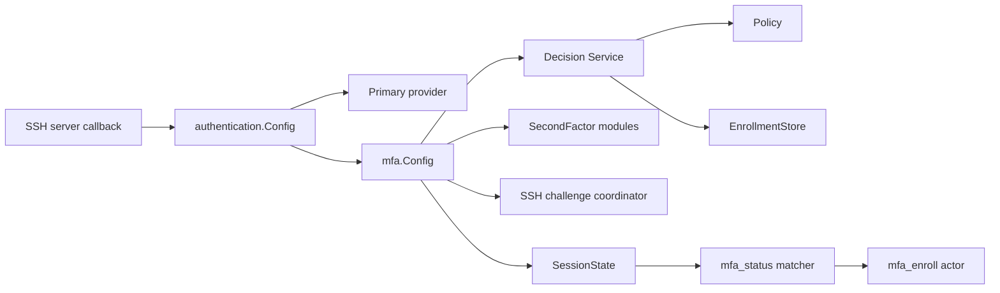

# MFA architecture and code trace

This document explains how the MFA implementation fits together and gives a
review order that follows execution. Use [MFA.md](MFA.md) for configuration
and operations. Use [MFA_REVIEW.md](MFA_REVIEW.md) for security findings and
the final review checklist.

## Mental model

MFA is a decorator, not a separate primary authentication provider:

```text
SSH callback
  -> primary provider
  -> canonical identity and authorization checks
  -> MFA decision
       -> allow during grace
       -> require enrollment
       -> require TOTP/recovery code
       -> allow touch-required sk-* policy bypass
  -> actors and session handlers
```

The primary provider still owns passwords, keys, OS accounts, and groups.
MFA owns enrollment state and the decision made after the primary provider
succeeds.

## Read the code in this order

| Step | File | What to review |
| --- | --- | --- |
| 1 | [`internal/ssh.go`](../../internal/ssh.go) | Server name is placed in the provisioning context. |
| 2 | [`internal/config.go`](../../internal/config.go) | `ProvidedConfig.Provision` binds the server name before authentication provisioning. |
| 3 | [`internal/authentication/config.go`](../../internal/authentication/config.go) | MFA module loading, primary callback wrapping, authorization, and canonical username handoff. |
| 4 | [`internal/authentication/mfa/service.go`](../../internal/authentication/mfa/service.go) | `AuthEvent`, `AuthDecision`, primary-factor policy, and the transport-independent decision service. |
| 5 | [`internal/authentication/mfa/mfa.go`](../../internal/authentication/mfa/mfa.go) | `Config.Provision`, `Wrap*`, and SSH translation in `continueAuthentication`. |
| 6 | [`internal/authentication/mfa/context.go`](../../internal/authentication/mfa/context.go) | The single connection-scoped `SessionState`. |
| 7 | [`internal/authentication/mfa/policy.go`](../../internal/authentication/mfa/policy.go) | Defaults, explicit zero grace, enforcement mode, and lockout math. |
| 8 | [`internal/authentication/mfa/challenges.go`](../../internal/authentication/mfa/challenges.go) | Existing-factor verification and auth-time enrollment. |
| 9 | [`internal/authentication/mfa/factors/totp/totp.go`](../../internal/authentication/mfa/factors/totp/totp.go) | Secret sealing, counter matching, and replay rejection. |
| 10 | [`internal/authentication/mfa/factors/recovery/recovery.go`](../../internal/authentication/mfa/factors/recovery/recovery.go) | Recovery-code generation, hashing, matching, and consumption. |
| 11 | [`internal/authentication/mfa/store/caddy/store.go`](../../internal/authentication/mfa/store/caddy/store.go) | Storage paths, seal key, per-user lock, and atomic update. |
| 12 | [`internal/authentication/mfa/matcher.go`](../../internal/authentication/mfa/matcher.go) and [`internal/actors/mfa_enroll.go`](../../internal/actors/mfa_enroll.go) | Post-auth status routing and full-terminal enrollment. |
| 13 | [`internal/authentication/mfa/command.go`](../../internal/authentication/mfa/command.go) | Filesystem-only admin inspection and reset. |

## Components and ownership



### `authentication.Config`

Responsibilities:

- Loads the optional MFA block.
- Wraps password, public-key, and interactive callbacks.
- Applies user and group authorization before MFA.
- Passes the provider's canonical username to MFA with
  `SetAuthenticatedUsername`.

This explicit handoff avoids an import cycle and prevents client-selected
aliases from becoming separate MFA identities.

### `mfa.Config`

Responsibilities:

- Loads the store and factor modules.
- Applies and validates policy defaults.
- Binds records to the current SSH server name.
- Decorates primary callbacks.
- Translates `AuthDecision` values into SSH allow, verify, or enroll behavior.
- Publishes the resulting `SessionState` for actors.

### `mfa.Service`

The service is the policy and state-transition boundary. It receives an
`AuthEvent` containing the canonical username, primary flow, normalized key
type, and no-touch status. It returns an `AuthDecision` containing:

- `ActionAllow`, `ActionVerify`, or `ActionEnroll`;
- the reason for that action;
- the current enrollment record and enforcement mode;
- primary-key metadata and the grace deadline when applicable.

The SSH adapter normalizes key and certificate permissions before building the
event. The service does not import SSH types or construct SSH callbacks. This
keeps policy tests independent from keyboard-interactive transport behavior.

`SKTouchPolicy` is a separate `PrimaryFactorPolicy`. It accepts only
touch-required OpenSSH `sk-*` credentials when the policy is enabled.

### `EnrollmentStore`

The store is keyed by `(server, canonical username)`.

There are two storage-module layers in JSON:

1. `mfa.store.backend` selects an `EnrollmentStore`; `caddy` is the default.
2. `mfa.store.storage.module` optionally selects the underlying
   `caddy.storage` backend used by that Caddy enrollment store.

The whole block may be omitted when using the default.

`Update` is the atomic primitive:

```go
Update(ctx, server, username, func(current *EnrollmentRecord) *EnrollmentRecord)
```

The Caddy implementation:

1. Validates scope components.
2. Acquires an in-process per-user mutex.
3. Acquires the distributed `ssh/mfa/<server>/<username>.lock`.
4. Loads the latest record.
5. Calls the mutation function.
6. Persists the returned record.
7. Releases both locks.

Returning `nil` from the mutation leaves the record unchanged.

### `SecondFactor`

A factor owns:

- enrollment artifact generation;
- its JSON blob schema;
- response verification;
- replay-sensitive updated state.

The orchestrator owns when that updated state is persisted.

## Provisioning trace

1. [`SSH.Provision`](../../internal/ssh.go) puts the server name in
   `CtxServerName`.
2. The provided server config is loaded and
   [`ProvidedConfig.Provision`](../../internal/config.go) calls
   `Authentication.BindServer`.
3. [`authentication.Config.Provision`](../../internal/authentication/config.go)
   decodes the MFA block and provisions `mfa.Config`.
4. [`mfa.Config.Provision`](../../internal/authentication/mfa/mfa.go):
   - rejects an empty or unsafe server name;
   - applies policy defaults;
   - loads the configured store;
   - loads factor modules;
   - gives the store seal key to factors that implement `SealKeyReceiver`;
   - sets the default verification order.

An absent MFA block skips steps 3 and 4 and leaves primary authentication
behavior unchanged.

## Authentication trace

### Common primary path

1. A primary provider returns an authenticated `User`.
2. `authentication.Config` checks allowed/denied users and groups.
3. It records the provider's canonical username in `SessionState`.
4. The selected `Wrap*` callback builds an `AuthEvent`.
5. `Service.Decide` returns an `AuthDecision`.
6. `continueAuthentication` translates the decision to SSH behavior.

If the canonical username is missing, MFA rejects authentication.

### `Service.Decide`

`Service.Decide` follows this order:

1. Reject a missing canonical username.
2. Ask the configured `PrimaryFactorPolicy` whether the primary credential
   also satisfies MFA.
3. Load the enrollment record.
4. Reject on storage error.
5. Reject an active lockout.
6. If enrolled, return `ActionVerify`.
7. If unenrolled, atomically persist and return `FirstSeenAt`. Failure is
   fatal.
8. Re-check the locked record in case enrollment completed concurrently.
9. During grace, return `ActionAllow`.
10. Outside grace, return `ActionEnroll`.

`continueAuthentication` stores the decision in `SessionState`, emits the
appropriate audit event, and translates verify/enroll decisions into SSH
partial-success callbacks.

The SK bypass intentionally does not need an enrollment record. The explicit
authenticated field in `SessionState` makes actor matching report `enrolled`
for that connection.

## Existing-factor verification

[`verifyChallenge`](../../internal/authentication/mfa/challenges.go) asks one
non-echo question, then calls `verifyAndCommit`.

`verifyAndCommit` performs the critical operation inside one store lock:

```text
load latest record
  -> re-check lockout
  -> decode factor blob
  -> verify response
  -> persist updated replay state
  -> reset failures
  -> set LastUsedAt
  -> write record
  -> grant access
```

This ordering is the central security invariant. A successful response is not
enough; the updated state must be durably stored before access is granted.

The transaction re-checks `LockedUntil`, so a connection cannot verify through
a lockout that began after its primary callback. On failure,
`registerFailure` updates the failure window and may set `LockedUntil`.

### TOTP replay state

The TOTP factor:

1. Opens the sealed secret.
2. Generates candidate values for the accepted counter window.
3. Compares candidates in constant time.
4. Rejects a matching counter that is not greater than
   `LastAcceptedCounter`.
5. Returns a copied blob with the new counter.

The orchestrator persists that blob within the same locked verification.

### Recovery-code replay state

The recovery factor:

1. Strips and normalizes the response in the orchestrator.
2. Hashes the response against each unused code entry.
3. Marks the matching entry with `UsedAt`.
4. Returns the updated blob.

Because verification sees the latest record while the lock is held, two
connections cannot consume the same code.

## Enrollment traces

### Auth-time enrollment

[`enrollmentChallenge`](../../internal/authentication/mfa/challenges.go):

1. Generates a TOTP secret and display artifact.
2. Shows the artifact over keyboard-interactive.
3. Verifies a TOTP confirmation code.
4. Keeps the returned accepted-counter state.
5. Generates recovery codes when that factor is available.
6. Encodes all blobs before opening the storage transaction.
7. Refuses to overwrite a record that became enrolled concurrently.
8. Persists the record.
9. Displays recovery codes.
10. Marks the connection MFA-authenticated.

### Actor enrollment

[`MFAEnroll.Handle`](../../internal/actors/mfa_enroll.go) performs the same
logical steps in a full SSH channel. It can render a terminal-friendly QR code
and allows three confirmation attempts.

With the default `skip_when_enrolled: true`, it checks enrollment both before
the wizard and again under the storage lock. This prevents a concurrent wizard
from replacing credentials.

## Session state and actor matching

[`context.go`](../../internal/authentication/mfa/context.go) stores one
synchronized `SessionState` object under a package-private context key.

Important values:

| Field | Purpose |
| --- | --- |
| `config` | Gives actors the provisioned store and factors through `ConfigFromCtx`. |
| `username` | Canonical identity from the primary provider. |
| `decision` | Action, reason, mode, enrollment record, and key metadata. |
| `flow` | Primary method that succeeded. |
| `authenticated` | MFA completed or policy explicitly satisfied it. |

`mfa_status` checks `authenticated` first, then classifies the decision's
record:

- authenticated or record with factors: `enrolled`;
- record with only `FirstSeenAt`: `pending`;
- otherwise: `unenrolled`.

The first grace login is immediately `pending` because the service returns the
record after `FirstSeenAt` is durably persisted.

## Persisted record

```text
EnrollmentRecord
├── Version
├── Server
├── Username
├── EnrolledAt
├── LastUsedAt
├── FirstSeenAt
├── Factors[name] -> factor-owned JSON
└── FailedAttempts
    ├── WindowStart
    ├── Count
    └── LockedUntil
```

TOTP uses SHA-256 or SHA-512 for HMAC; SHA-1 is rejected during provisioning
and when reading persisted factor state. TOTP secrets are sealed with a
store-wide key. Recovery codes are hashed.
The default store keeps the seal key in the same backend namespace, so the
sealing boundary is isolated record access, not complete backend compromise.

## Security invariants to review

1. **Canonical identity:** only the authenticated provider's username scopes
   MFA state.
2. **Server isolation:** every record operation has a validated server name.
3. **Fail closed:** enrollment loads, replay-state writes, and first-seen
   writes must succeed before access is granted.
4. **Atomic replay protection:** factor verification and updated state are one
   locked transaction.
5. **No-touch handling:** `no-touch-required` prevents an SK policy bypass.
6. **Enrollment conflict protection:** a concurrent enrollment is not silently
   replaced.
7. **Actor continuity:** successful MFA is carried into actor matching.
8. **Path safety:** server and username cannot escape their storage namespace.

## Extension points

- Add a factor by implementing `SecondFactor` and optionally `NewBlob` and
  `SealKeyReceiver`.
- Add a store by implementing `EnrollmentStore`.
- Extend policy in `Policy`, then update `Service.Decide` and service tests.
- Add actor behavior through `SessionState` accessors; do not add independent
  context keys or re-read a client-supplied username.

## Test map

| Area | Tests |
| --- | --- |
| Policy and sealing | `internal/authentication/mfa/policy_test.go` |
| Atomic verification, identity, grace, and SK permissions | `internal/authentication/mfa/security_test.go` |
| TOTP and replay | `internal/authentication/mfa/factors/totp/totp_test.go` |
| Recovery codes | `internal/authentication/mfa/factors/recovery/recovery_test.go` |
| Store locking and scope validation | `internal/authentication/mfa/store/caddy/store_test.go` |

Run the focused suite with:

```text
go test -race ./internal/authentication/mfa/... ./internal/authentication ./internal/actors
```
